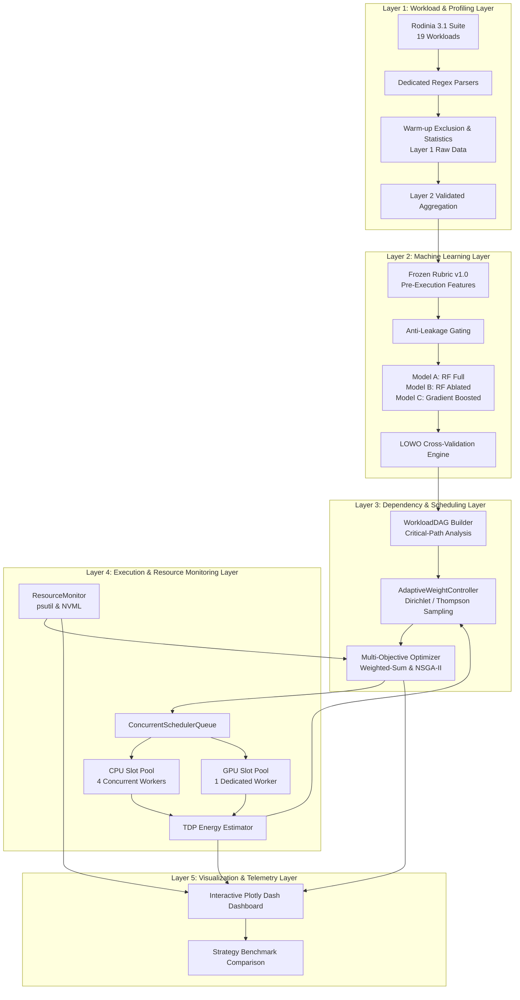

# PROJECT ARCHITECTURE & SYSTEM DESIGN
## AI-Driven Adaptive CPU–GPU Workload Scheduling and Multi-Objective Optimization for Cloud HPC

---

## 1. System Overview

Modern Cloud High-Performance Computing (HPC) clusters deploy heterogeneous compute nodes featuring multi-core CPUs coupled with discrete accelerators (GPUs). Maximizing cluster throughput while minimizing makespan, energy consumption, and interconnect contention requires intelligent workload placement.

This system provides an end-to-end autonomous framework that:
1. Profiles and extracts intrinsic algorithmic characteristics of HPC workloads before execution.
2. Uses machine learning (Random Forest and Gradient Boosted decision trees) to predict optimal execution placement (CPU vs GPU) with zero runtime data leakage.
3. Formulates a Directed Acyclic Graph (DAG) with critical-path priority calculations to manage task dependencies.
4. Samples multi-objective priority weights via Bayesian Thompson Sampling from a Dirichlet posterior distribution.
5. Optimizes task assignments across concurrent CPU and GPU slot pools using scalarized weighted-sum and Pareto-based NSGA-II algorithms.
6. Re-tunes scheduling priorities dynamically using online reinforcement feedback loops based on empirical makespan and energy costs.
7. Surfaces real-time hardware telemetry and scheduling decisions through an interactive live dashboard.

---

## 2. Five-Layer Architectural Model



---

## 3. Data Flow & Component Pipeline

### 3.1 Workload Characterization Pipeline
```
Raw Benchmark Source Code
    │
    ├──> Algorithmic Analysis (Arithmetic Intensity, Memory Access Indirection)
    │
    └──> Frozen Rubric v1.0 Mapping
            ├──> Numerical Features (input_size_mib, estimated_parallelism, compute_intensity)
            ├──> Categorical Features (workload_type, workload_domain)
            └──> Transfer Estimate (estimated_transfer_size_mib = input_size_mib * transfer_ratio)
```

### 3.2 Machine Learning Inference Pipeline
```
Pre-Execution Features (No Post-Execution Leakage)
    │
    ▼
OrdinalEncoder (fitted strictly on training fold)
    │
    ▼
Random Forest Pipeline (100 estimators, max_depth=5)
    │
    ├──> Device Placement Decision: {CPU: 0, GPU: 1}
    ├──> Confidence Score: P(class | features)
    └──> Speedup & Transfer Overhead Ratio Estimates
```

### 3.3 Scheduling Optimization Pipeline
```
Task DAG + ML Placement Metadata
    │
    ├──> Critical-Path Priority Assignment
    │
    ├──> System Pressure Telemetry (ResourceMonitor CPU/RAM load)
    │
    ├──> Dirichlet Thompson Sampling [w_makespan, w_energy, w_transfer]
    │
    ├──> Multi-Objective Solver:
    │       f1 = Makespan (simulated parallel slot completion)
    │       f2 = Energy Proxy (TDP_Watts * Runtime_Seconds)
    │       f3 = Transfer Overhead (PCIe Transfer Time)
    │
    └──> Concurrent Slot Allocation (4 CPU Slots, 1 GPU Slot)
            │
            ▼
    Execution & Feedback Loop (Bayesian alpha update: alpha += lr * norm_cost)
```

---

## 4. Hardware and Environmental Fault Tolerance

When running in heterogeneous HPC clusters or constrained environments:
1. **NVIDIA CUDA Available**: The scheduler dispatches native compiled CUDA binaries to `GPUExecutor` and collects live telemetry via `nvidia-smi` / NVML.
2. **CUDA / GPU Unavailable**: The scheduler gracefully routes tasks to `SimulatedExecutor`, which replays empirical Tesla T4 benchmark distributions (median + standard deviation jitter).
3. **No GPU Telemetry Fabrication**: The `ResourceMonitor` explicitly reports `GPU_MONITORING_UNAVAILABLE` rather than generating synthetic GPU usage.
4. **Energy Model Clarity**: Energy metrics are calculated via calibrated Thermal Design Power (TDP) models and explicitly tagged as `ESTIMATED_NOT_MEASURED`.

